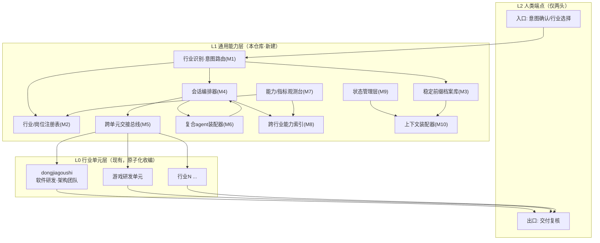

# 「行行出状元」通用能力层 · 顶层架构 v0.2

> 架构·总师 | 2026-09-05 | Issue #1
> 输入：`docs/architecture/通用能力-需求澄清基线.md`（产品/CodeBuddy 交接基线）
> 定位：本仓库只做「跨行业/跨岗位的路由编排总层」，具体行业单元内部细节不在此重建。

---

## 0. 一句话定位

**把各「行业单元」（如 `dongjiagoushi` 架构团队）当原子收编，在其上叠一层「自动识别行业/岗位 → 路由 → 交接 → 交叉 → 复合装配」的总编排层。**

- `dongjiagoushi` = 一个行业单元的**内部**多 agent 协作（已实现）。
- 本层 = 行业单元的**外部/上层**编排，覆盖多个行业、自动识别、无需用户切模式。

---

## 1. 分层模型



---

## 2. 模块清单

| # | 模块 | 职责 | 输入 | 输出 | 依赖 | 风险 |
|---|------|------|------|------|------|------|
| M1 | 行业识别·意图路由 | 解析自然语言→识别 行业→岗位，路由到对应单元 | 用户文本 | 行业标签+路由指令 | 无 | MED-歧义 |
| M2 | 行业/岗位注册表 | 抓取各单元 `industry-register.yaml` 入库 | 单元声明 | 单元能力清单 | 单元仓库 | 低 |
| M3 | 稳定前缀档案库 | 固化各行业/岗位稳定前缀模板 | 行业定义 | 前缀协议 | M2 | **HIGH-前缀突变** |
| M4 | 会话编排器 | 决策：单直连/跨单元交接/复合装配；维持会话前缀稳定 | 路由指令 | 编排计划 | M1..M3 | MED |
| M5 | 跨单元交接总线 | 跨行业/跨岗位接力（复用基座 Relay/接力卡协议） | 交接指令 | 交接卡+状态 | 基座单元 | MED-跨库上下文 |
| M6 | 复合agent装配器 | 动态叠加 ≥2 岗位为复合 agent + 跨界加能力 | 岗位组合 | 复合上下文 | 各单元 | **HIGH-上下文冲突** |
| M7 | 能力/指标观测台 | 统计切换/交接/复合并发/人工介入率 | 运行日志 | 指标 | 全部 | 低 |
| M8 | 跨行业能力索引 | 索引各单元能力入口供编排检索 | 注册表+日志 | 可检索索引 | M2 | 低 |
| M9 | 状态管理层 | 任务状态卡+折叠索引+层级提交+秘书长多级树+秘书并发归属/冲突仲裁 | 任务/对话原文 | StateCard+渲染层+树拓扑 | M2/M5 | MED-折叠边界 |
| M10 | 上下文装配器 | 三层拼装+规则表触发+缓存隔离（防提示词冗余） | 角色+StateCard+触发文本 | 分层上下文+缓存键 | M3/M9 | MED-规则覆盖不全 |

---

## 3. 核心机制

### 3.1 自动识别路由（不切模式）
- 首输入 `M1` 做 意图→行业→岗位 多级识别，命中后自动路由，无手动切模式。
- 信号源：各单元在 `industry-register.yaml` 里提供的 `industry_alias` + `capability_tags`。
- 多级判定：先定行业（词面/领域），再定岗位（动词/对象/技能词）。
- 置信度低 → 回落至 L2 入口人工一次确认（仅开头端点）。

### 3.2 稳定前缀策略（不污染上下文、保住缓存命中）
基线要求："同 session 前缀稳定，或分到不同对话各自稳定前缀"。**本设计定策：**

- **强约束：一个 session = 一个行业单元 = 一套稳定前缀。** 中途禁止跨行业。
- 跨行业/跨岗位 = **开新 session**，用 `M5` 交接卡接力（复用基座 Relay 协议）。
- 每个行业单元维护一份 `前缀档案`（存 `M3`），列出各岗位稳定前缀，禁止运行期改写。
- 复合 agent（同一行业多岗位）**允许**在同一 session 内并行岗位，但前缀仍取该行业固定集合，不插入外部行业前缀 → 保证缓存命中键稳定。
- 跨界能力 = 向该单元**叠加**新岗位能力描述（增量），不覆盖既有前缀。

### 3.3 交接与交叉
- 跨行业复合诉求 → `M4` 拆成子任务 → 各落到对应单元新 session → 结果经 `M5` 汇合。
- 交叉 = 一个子任务需要 A 行业出架构 + B 行业产资源，按依赖做 DAG 波次调度（复用基座 graph/fractal 思路到 L1 层）。

### 3.4 复合型 agent（达标信号）
- `M6` 在**同一行业稳定前缀集合**内装配 ≥2 岗位（如架构师+开发）并发。
- 跨界复合 = 触发多单元交接（非同 session 拼接）。
- 能力达标量化信号（基线追问4）：
  ① 同 session 不切模式、缓存不失效即可完成跨**岗位**切换；
  ② 能形成 ≥2 岗位复合 agent；
  ③ 可动态挂载跨界能力而无需重构。

### 3.5 人工两头化
```
L2入口[人工:意图确认] ──> L1 全自动(0人工:路由/交接/复合/重试) ──> L2出口[人工:复核]
```
- 中间失败由机制重试/降级/兜底，不弹人工。
- 仅整链确定性失败才汇入出口人工复核区。

---

## 4. 单元接入契约

各行业单元仓库根放 `industry-register.yaml`（本层 `M2` 抓取）。规范见 `docs/industry/register-spec.md`。核心字段：

```yaml
unit_id: dongjiagoushi
industry: 软件研发
industry_alias: [研发, 架构师, dev]
roles:
  - {name: architect, prefix: "[架构]", handoff: relay, composite: true}
  - {name: developer, prefix: "[开发]", handoff: relay, composite: true}
entry_ref: "https://cnb.cool/dongdongxiaozu/dongjiagoushi"
capability_tags: [架构设计, 编码, 协作编排, 经验记忆]
register_version: "1.0"
```

---

## 5. 可行性验证

| 假设 | 可行/风险 | 对策 |
|------|----------|------|
| `dongjiagoushi` 作为首个行业单元 | ✅ | 已有完整多agent协作/接力/记忆，直接注册 |
| 跨仓库(单元)协作 | 🟡 跨库上下文天然断 | 正因此分层：跨库=新会话+交接卡，不强拼 |
| 同 session 前缀稳定 | ✅ | "一会话一行业"强约束 |
| 复合 ≥2 岗位 | 🟡 上下文共享冲突 | 装配器定角色优先级+共享/隔离边界 |
| 中间零人工 | ✅ | 机制重试/降级 |
| 自动路由不切模式 | ✅ | M1 多级识别 |

---

## 6. 里程碑与索引

| 里程碑 | 内容 | 状态 |
|--------|------|------|
| CP1 | 本通用能力层架构评审 | ⏳ 人工放行口 |
| CP2 | 收编单元为原子 + 自动路由跑通 | ✅ R4/R5/R6 POC通过 + Python正式引擎实现(src/hanghang/) |
| CP3 | 跨单元交接 + 复合agent(≥2岗) | ✅ M5交接总线集成(自动建卡) + 复合boundary规则已实现 + 跨单元交接测试通过 |
| P2 | 扩展更多行业单元 | ✅ game-dev-unit已完善(含game_dev角色+完整keywords) |
| R8 | 数据驱动路由升级 | ✅ Role模型增加keywords字段, 注册数据驱动, 新增单元无需改代码 |
| R9 | 复合agent边界规则 | ✅ role_priority+role_isolation规则已落地(评审补强①) |
| R10 | 缓存命中稳定性验证 | ✅ 同义改写/重复提交一致性测试已添加(评审补强②) |
| R11 | 行业横向扩展(3→5) | ✅ 新增 法律咨询/内容创作/数据分析 三单元, 纯数据驱动无改代码, 验证"行行出状元"广度覆盖 |
| R12 | M8 能力索引增强 | ✅ search_capability 多维检索(any/industry/capability/role) + capability_index 全量导出 + CLI `search --mode`/`index` |

**索引**
- 顶层架构(本文件)：`docs/architecture/ARCHITECTURE.md`
- 需求基线：`docs/architecture/通用能力-需求澄清基线.md`
- 单元接入规范：`docs/industry/register-spec.md`
- 电子书旧档(迁出)：`docs/legacy/ebook-sousuozengqiang/`

---

## 7. 风险与决策

### 风险
| 级别 | 风险 | 规避 |
|------|------|------|
| HIGH | 同 session 前缀突变污染上下文/失缓存 | "一会话一行业"强约束 |
| HIGH | 复合 agent 上下文共享冲突 | 装配器定优先级+边界 |
| MEDIUM | 跨库上下文断裂 | 新会话+接力卡 |
| MEDIUM | 行业识别歧义 | 置信低回落入口一次确认 |
| LOW | 注册表抓取失败/单元演进 | 定期刷新+版本兼容 |

### 决策摘要
| 决策 | 状态 |
|------|------|
| 本仓库=跨行业通用能力层 | ✅ |
| 电子书迁出 sousuozengqiang | ✅ |
| 人工两头化 | ✅ |
| 一会话一行业·稳定前缀 | ✅ |
| 复合agent≥2为达标信号 | ✅ |
| 技术栈 | ✅ Python正式实现(src/hanghang/), bash POC已验证概念可行性 |

> 📊 **架构·总师** | 待 CP1 人工评审放行后进入开发。
> 📝 **CodeBuddy** | 2026-09-05: 已将 POC 升级为正式 Python 实现，包含 M1-M8 核心引擎代码。
> 📝 **CodeBuddy** | 2026-09-06: 新增 M9 状态管理层(StateCard/StateManager/FoldEngine/HierarchySubmitter)，实现任务状态机+折叠索引+层级向上提交，秘书分工机制落地。
>
> 📝 **CodeBuddy** | 2026-09-07: M9 增强版——新增 SecretaryTree/SecretaryTreeNode 秘书长多级树拓扑（多级注册/关系/rollup/渲染），HierarchySubmitter 支持 submit_chain_up 逐级向上提交。M9 接入主执行链路：CompositePlanner 自动创建 StateCard，HandoffBus auto_state_card 自动关联。新增 POC 量化验证脚本 poc/state_m9_benchmark.py。
> 📝 **CodeBuddy** | 2026-09-07: M9 补多秘书协作拼图——新增 OwnershipGuard(秘书并发归属与冲突仲裁)：StateCard 增 owner+乐观版本号，claim/release 归属声明、租约写锁、基于 base_version 的乐观并发冲突检测(StateConflict)与越权拒绝(OwnershipDenied)。补 Issue#5/论文 SKILL.state 明示的"多 Agent 并发写状态需确定性冲突处理"缺口。
> 📝 **CodeBuddy** | 2026-09-07: 新增 M10 上下文装配器——三层物理隔离（静态层A/会话态层B/规则注入层C），R3声明式规则表引擎，M10-d缓存保护（静态/动态隔离校验）。Issue #11 防提示词冗余核心落地。
