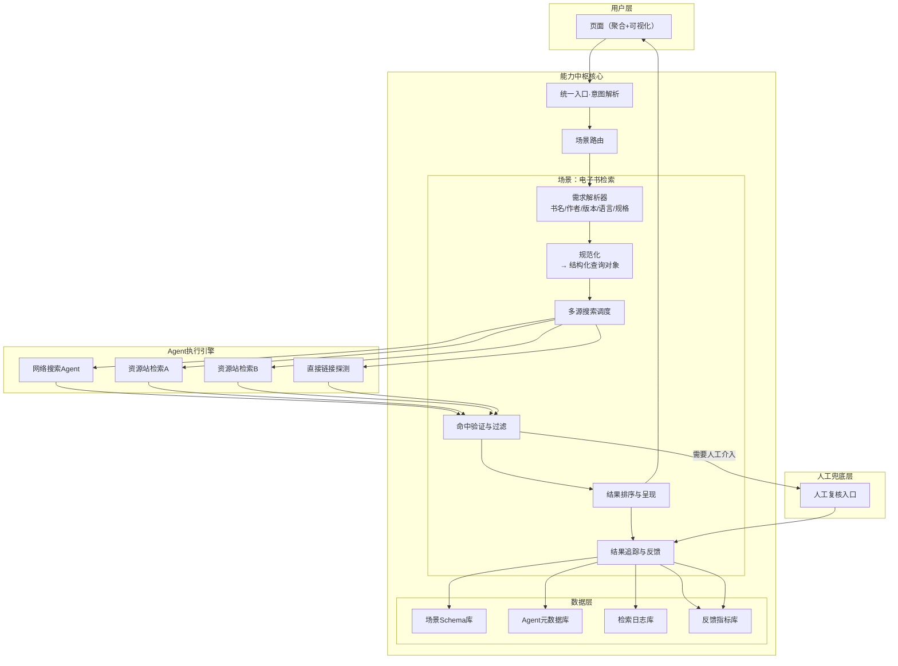

# 「行行出状元 · 个人能力中枢」— 架构设计 v0.1

> 架构·总师 | 2026-09-04 | Issue #1

---

## 0. 前置声明

**本设计基于 Issue #1 全部 5 条评论的完整上下文。**
- 定位：个人能力中枢（个人私有 → 能力达标后生态化演进）
- 阶段：MVP 先跑通 **1 个场景**（电子书检索）→ 验证机制 → 横向复制
- 首场景已明确：**多版本电子书检索**（含资源版本/语言/规格差异识别）

---

## 1. 调研结论

### 1.1 用户（人类）侧关键输入
| # | 输入 | 影响 |
|---|------|------|
| 1 | 书籍有多个版本/语言/规格变体 | 检索需支持**结构化版本消歧** |
| 2 | 人工兜底是后置而非前置 | 架构**默认自动推进**，人工仅异常介入 |
| 3 | 查询成功率 ≥80% 算合格，≥90% 优秀 | 必须有**可度量指标 + 自动反馈闭环** |
| 4 | 不存在资源的允许查不到 | 需区分"没有"与"没查到"两类失败 |
| 5 | 不能无限查询（设上限） | 每次检索需有**确定性终止条件** |
| 6 | 首个交互形态为"页面" | MVP 前端=聚合+可视化页面 |

### 1.2 参考与既有能力调研
- 目标：用 CNB NPC Agent（含网络搜索）作为**执行引擎**来查资源
- 检索来源：公开网络（Z-Library镜像、LibGen、archive.org、出版社官网等）
- 难点：来源不稳定、部分资源不合法或不存在、版本歧义
- 参考：现有搜索 Agent 的启发式做法 + 确定性规则引擎兜底

---

## 2. 顶层架构拓扑

### 2.1 架构图（Mermaid）



### 2.2 模块清单

| # | 模块名 | 职责 | 输入 | 输出 | 依赖 | 风险 |
|---|--------|------|------|------|------|------|
| M1 | 统一入口·意图解析 | 接收用户自然语言输入，识别意图类型 | 用户文本 | 意图类型+载荷 | 无 | 低 |
| M2 | 场景路由 | 依据意图路由到对应场景执行器 | 意图类型 | 场景执行上下文 | M1 | 低 |
| M3 | 需求解析器（电子书） | 从用户描述中抽取 书名/作者/版本/语言/规格 等结构化字段 | 场景执行上下文 | 结构化查询对象 | M2 | MEDIUM - 版本歧义 |
| M4 | 规范化引擎 | 将字段归一化为可检索形态（别名/ISBN/规范名） | 结构化查询对象 | 规范化查询参数 | M3, DB.SCHEMA | 低 |
| M5 | 多源搜索调度 | 并发调度多个Agent/来源，设定超时与轮次上限 | 规范化查询参数 | 候选命中列表 | M4, AGENT集群 | MEDIUM - 来源不稳定 |
| M6 | 命中验证与过滤 | 校验候选命中是否真实可用/版本匹配/规格符合 | 候选命中列表 | 验证通过的命中集 | M5 | MEDIUM - 需要启发式判断 |
| M7 | 结果排序与呈现 | 按相关性排序，返回页面数据 | 命中集 | 页面响应数据 | M6 | 低 |
| M8 | 结果追踪与反馈 | 记录查询结果、用户是否采纳、失败原因分类 | 页面交互事件 | 反馈记录 → DB | M7 | 低 |
| M9 | 人工复核入口 | 供人工在自动流程失败后介入修正 | 待人工判定记录 | 人工标注结果 | M6/M8 | 低 |
| DB1 | 场景Schema库 | 存储各场景的规范化规则与版本映射 | - | Schema定义 | - | 低 |
| DB2 | Agent元数据库 | 存储各Agent能力描述/可用性状态 | - | Agent清单 | - | 低 |
| DB3 | 检索日志库 | 全量检索行为记录（含耗时/来源/轮次） | - | 日志 | - | 低 |
| DB4 | 反馈指标库 | 成功/失败统计、准确率、人工介入率 | - | 指标数据 | - | 低 |
| A1 | 网络搜索Agent | 用搜索引擎/站内搜索做资源发现 | 查询参数 | 候选链接 | - | 中 |
| A2 | 资源站检索Agent | 直接向已知电子书源站发起查询 | 查询参数 | 候选命中 | - | 中 |
| A3 | 直接链接探测 | 对已知 URL 模式做可达性/内容探测 | URL模式 | 可用性判断 | - | 中 |

---

## 3. 可行性验证

| 假设/要素 | 可行/风险 | 说明 | 对策 |
|----------|----------|------|------|
| NPC Agent 可做网络搜索 | ✅ 可行 | CNB NPC 具备工具调用能力 | 直接复用 |
| 多版本消歧（第6版中/第10/12版英/extended） | 🟡 风险 | 书名/版本组合在自然语言中信息密度高 | 构建书籍版本Schema + 规则化解析 + 多轮澄清兜底 |
| 电子书源可用性 | 🟡 风险 | 外部源不稳定且部分非法 | 多源并行 + 来源健康度跟踪 |
| 区分"没有"vs"没查到" | ✅ 可行 | 基于搜索轮次+来源覆盖率+规则判定 | 设终止条件后若零命中则标记"未确认存在" |
| 成功率可量化 | ✅ 可行 | 每次用户采纳/弃用可埋点 | 成功=用户确认采纳；失败=无命中/弃用 |
| 自动推进（人工兜底后置） | ✅ 可行 | Agent默认自动执行完整链路 | 仅在验证不可靠或查询失败时弹人工入口 |
| 前端页面聚合展示 | ✅ 可行 | 一个页面即可 | Web 前端 |

---

## 4. 工程实施方案

### 4.1 仓库目录结构

```
hanghangchuzhuangyuan/
├── docs/
│   ├── architecture/
│   │   └── ARCHITECTURE.md        # 本文档
│   └── contracts/
│       └── ebook-search.md         # 电子书检索场景契约
├── src/
│   ├── core/                       # 核心中枢
│   │   ├── gateway.py              # M1 统一入口·意图解析
│   │   ├── router.py               # M2 场景路由
│   │   ├── feedback.py             # M8 结果追踪与反馈
│   │   └── orchestrator.py         # 场景编排器（总控）
│   ├── scenes/
│   │   └── ebook_search/           # 电子书检索场景
│   │       ├── parser.py           # M3 需求解析器
│   │       ├── normalizer.py       # M4 规范化引擎
│   │       ├── scheduler.py        # M5 多源搜索调度
│   │       ├── verifier.py         # M6 命中验证与过滤
│   │       ├── ranker.py           # M7 结果排序
│   │       └── schema.yaml         # 书籍版本Schema
│   ├── agents/                     # Agent执行引擎
│   │   ├── web_search.py           # A1 网络搜索Agent
│   │   ├── source_sites.py         # A2 资源站检索Agent
│   │   └── url_probe.py            # A3 直接链接探测
│   ├── storage/                    # 数据层
│   │   ├── models.py               # 数据模型定义
│   │   └── db.py                   # 数据库访问
│   └── api/
│       ├── app.py                  # Web API入口
│       └── routes.py               # 路由定义
├── frontend/                       # 页面前端
│   ├── index.html
│   └── assets/
├── tests/
│   └── ...
└── requirements.txt
```

### 4.2 接口契约

**输入示例**（自然语言）：
```
我想找《物理学基础》哈里德著的电子版，第6版中文版（张三慧翻译）或者第10/12版英文extended版
```

**结构化查询对象**（M3输出）：
```json
{
  "scene": "ebook_search",
  "title": "物理学基础",
  "author": "哈里德",
  "versions": [
    {"edition": 6, "lang": "zh", "translator": "张三慧"},
    {"edition": [10, 12], "lang": "en", "edition_type": "extended"}
  ]
}
```

**规范化查询参数**（M4输出）：
```json
{
  "query_groups": [
    {"keywords": "Fundamentals of Physics Halliday Resnick", "lang": "en", "edition": 10, "type": "extended", "aliases": ["Extended 10th Edition"]},
    {"keywords": "物理学基础 哈里德 第6版 张三慧", "lang": "zh"},
    ...
  ],
  "search_limit": 5,
  "timeout_sec": 30
}
```

**最终响应**（页面数据）：
```json
{
  "query_id": "q-20260904-001",
  "results": [
    {
      "match": "match",
      "book": "Fundamentals of Physics Extended, 10th Edition",
      "lang": "en",
      "edition": 10,
      "format": ["pdf", "epub"],
      "source": "source_site_a",
      "url": "...",
      "confidence": 0.87
    }
  ],
  "unconfirmed_editions": ["12th_en_extended"],
  "human_review_needed": false,
  "elapsed_ms": 18500
}
```

### 4.3 关键规则

**成功率定义**：`有资源但成功返回资源` / `有资源且用户确认` ≥ 80%
**失败分类**：
- `NOT_FOUND` = 搜索多源+多轮后零命中 → 判定"该资源可能不存在"
- `NOT_MATCHED` = 找到资源但与用户要求的版本/规格不符
- `UNVERIFIED` = 找到链接但无法验证可用性
- `TIMEOUT` = 超过搜索轮次/时间上限

**自动终止条件**（不无限查询）：
- 默认最多 3 个独立来源、每来源最多 2 轮搜索
- 总时长上限 60 秒
- 已确认命中后可提前终止

---

## 5. 分工与协作规则

| 角色 | 职责 | 与架构总师的关系 |
|------|------|------------------|
| **架构·产品** | 需求澄清、用户故事维护 | 产品契约输入 → 架构设计 |
| **架构·开发** | 按本架构方案实现代码 | 接架构方案落地编码 |
| **架构·秘书** | 入口承接、沟通协调 | 前期已交接 |
| **人类（张浩东）** | 兜底决策、版本Schema人工补全、异常修正 | 最终拍板人 |
| **架构·总师（我）** | 整体架构设计、可行性评估、进度把关 | 本设计产出方 |

**接力规则**：
1. 产品产出契约 → 总师出架构 → 开发编码 → 测试验收 → 总师复核
2. 每次角色变更，以 Issue 评论为交接卡（含: 输入/输出/风险）
3. 架构文档以本仓库 `docs/` 下 markdown 文件为准

---

## 6. 进度对齐（里程碑）

| 里程碑 | 内容 | 预计 | 状态 |
|--------|------|------|------|
| CP1 | 架构方案评审通过 | 本评论后 | ⏳ 待批准 |
| CP2 | 电子书场景代码实现 + 首端到端跑通 | CP1后 | pending |
| CP3 | 测试验收 + 指标达标（≥80%） | CP2后 | pending |
| P2 | 横向复制到第2个场景 | P1后 | pending |

---

## 7. 索引

| 产物 | 位置 |
|------|------|
| 本架构文档 | `docs/architecture/ARCHITECTURE.md` |
| 电子书场景契约 | `docs/contracts/ebook-search.md` |
| 需求对话历史 | Issue #1 评论区 |
| 产品契约 | Issue #1 评论 #3 |

---

## 8. 风险清单与决策摘要

### 风险清单
| 级别 | 风险 | 规避方案 |
|------|------|----------|
| HIGH | 外部电子书源不稳定/不合法 | 多源并行+来源健康度跟踪+人工兜底 |
| MEDIUM | 版本歧义导致错误匹配 | 版本Schema+规则化解析+置信度阈值+澄清交互 |
| MEDIUM | NPC搜索能力限制（工具依赖） | Agent能力检测+降级到人工入口 |
| LOW | 指标采集不完整 | 全链路日志埋点 |
| LOW | 前端页面复杂化 | 约束只做聚合+展示 |

### 决策摘要
| 决策 | 状态 |
|------|------|
| MVP 首场景 = 电子书多版本检索 | ✅ 已定 |
| 自动推进+人工后置兜底 | ✅ 已定 |
| 成功率≥80%为验收线 | ✅ 已定 |
| 页面为首次交互形态 | ✅ 已定 |
| 技术栈选择 | ⏳ 待开发角色确认（Python/Node均可） |

---

> 📊 **架构·总师** | 本文档待 CP1 人工评审后进入开发阶段
