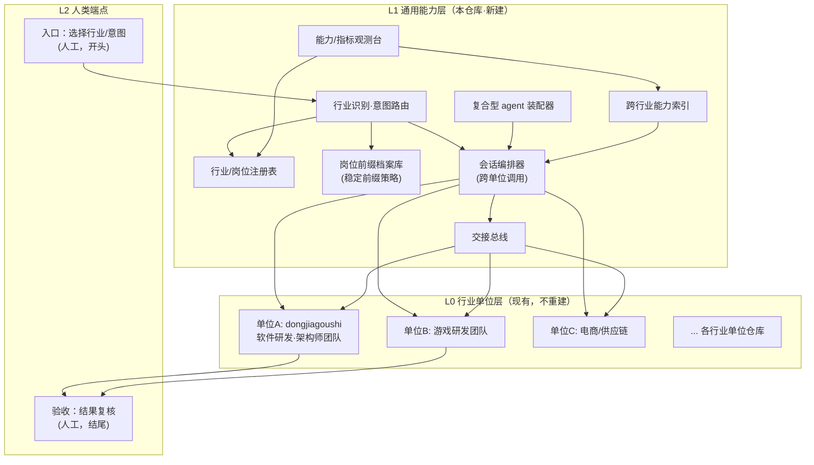

# 「行行出状元 · 行业能力中枢」— 通用能力层架构设计 v0.2

> 架构·总师 | Issue #1 | 定位修正版

---

## 0. 前置声明（范围澄清）

**本仓库 `hanghangchuzhuangyuan` 只承载「跨行业通用能力层」，不再承载具体行业场景。**
- ❌ 移除：电子书检索（多版本消歧）等**具体垂直场景**
  → 归属 **`sousuozengqiang`（搜索增强）** 项目，另开 Issue/PR 独立演进
- ✅ 保留：**通用能力层 = 以基座单位之上做多行业/多岗位的编排枢纽**
- 本设计基于 Issue #1 评论中的 5 个澄清问题（用户已作答）

### 参照系（已调研确认）
| 仓库 | 定位 | 本层关系 |
|------|------|----------|
| `dongdongxiaozu/dongjiagoushi` | **基座单位**：一套"架构师团队"= 公司+岗位聚合，完成**单位内**多 agent 切换 + 协作交接 + 岗位复合 | 本层以它为**一个行业单位**（软件研发行业） |
| `dongdongxiaozu/hanghangchuzhuangyuan` | **本仓库**：覆盖各行业/岗位，自动识别路由、跨行业交接、复合型 agent、跨界加能力 | **更高一层**：多单位编排枢纽 |

**核心命题**：`dongjiagoushi` 解决"**一个行业单位内部** agent 怎么协作"，本层解决"**多个行业单位之间**怎么被调度、路由、交接、交叉、复合"。

---

## 1. 澄清问题 → 用户定案（先行对齐，避免臆造）

| # | 原追问 | 用户定案 | 对架构的影响 |
|---|--------|----------|-------------|
| 1 | 首场景=哪个业务 | 不指定单个业务；本层是**行业编排**，`dongjiagoushi`(架构师团队/软件研发) 为首个已存在基座单位 | 边界从"场景"升为"行业单位" |
| 2 | 具体用例/能力清单在哪 | 参考 `dongjiagoushi` 这类仓库 → 本层不臆造细节，以单位仓库为能力事实来源 | 单位能力以**注册表**驱动，非硬编码 |
| 3 | 人工兜底触发点/层级 | 人工只在**开头(意图确认)与结尾(验收)**，中间尽量零人工；依赖机制与自动化 | 中间层纯自动；人工是端点而非流程节点 |
| 4 | "能力足够高、可转生态"的量化信号 | 正常使用**不切模式**即可跨行业切换；能同时运行 **≥2 岗位的复合型 agent**；可**动态加跨界能力** | 双可判据：**同会话稳定前缀** + **复合并发 ≥2** |
| 5 | 聚合+可视化数据源/首交互形态 | 在 cnb.cool / deepseek harness 生态内，以 `dongjiagoushi` 为**单位**做协作，横向扩展多行业，做行业路由/交接/交叉 | 交互=跨库协作路由（上层的上层） |

---

## 2. 顶层架构拓扑

### 2.1 分层视图



### 2.2 模块清单

| # | 模块 | 职责 | 输入 | 输出 | 依赖 | 风险 |
|---|------|------|------|------|------|------|
| L1-M1 | 行业识别·意图路由 | 解析自然语言，识别所属行业/岗位意图，路由到对应基座单位 | 用户文本 | 行业标签+路由指令 | 无 | MEDIUM-识别歧义 |
| L1-M2 | 行业/岗位注册表 | 登记各基座单位的行业/岗位/能力边界/入口地址 | 单位声明 | 单位能力清单 | 单位仓库 | 低 |
| L1-M3 | 岗位前缀档案库 | 为每个行业/岗位固化**稳定前缀模板**，保证同会话不突变 | 行业定义 | 前缀协议 | L1-M2 | HIGH-前缀突变 |
| L1-M4 | 会话编排器 | 决策：单单位直连 or 跨单位交接 or 复合装配；维护会话内前缀稳定 | 路由指令+目标 | 编排计划 | L1-M1..M3 | MEDIUM |
| L1-M5 | 交接总线 | 跨行业单位间接力（接力卡协议复用基座 Relay） | 交接指令 | 交接卡+状态 | 基座单位 | MEDIUM |
| L1-M6 | 复合型 agent 装配器 | 动态组合 ≥2 岗位能力为一复合 agent，跨界加能力 | 岗位组合声明 | 复合上下文 | 各单位 | HIGH-上下文冲突 |
| L1-M7 | 能力/指标观测台 | 统计切换成功率/交接成功率/复合并发数/人工介入率 | 运行日志 | 指标 | 全部 | 低 |
| L1-M8 | 跨行业能力索引 | 索引各单位能力入口，供编排/交接检索 | 注册表+日志 | 可检索索引 | L1-M2 | 低 |

---

## 3. 核心机制设计（本层灵魂）

### 3.1 稳定前缀策略（用户关切 #1）——**防提示词突变**

**问题**：跨行业切换时提示词会变化；若同一 session 内前缀突变为另一种行业，会污染上下文。

**两条实现路径（择一或混合）：**
- **路径A「会话内同前缀」**：路由后进入某行业，该行业会话全程保持单一稳定前缀；跨行业需交接时走**新会话**。
- **路径B「会话外隔离 = 分会话定前缀」**：不同行业落到**不同会话/对话**，每个会话自形成稳定前缀，天然隔离。

**设计约束**：
- **一个 session = 一个行业单位 = 一套稳定前缀**（强约束，禁止同 session 中途换行业）。
- 跨行业 = 开新 session 并按 `L1-M4` 交接。
- 前缀档案存于 `L1-M3`，由注册表驱动，避免硬编码散落。

### 3.2 自动路由（用户关切「不用切换模式」）
- 首输入做行业识别 `L1-M1`，命中后**自动路由**到对应单位，不要求用户手动选模式。
- 识别置信度低时，仅回落到入口处人工一次确认（人工只在端点）。

### 3.3 复合型 agent（用户关切「≥2 岗位并发 + 动态跨界」）
- 允许在一个稳定前缀会话内**动态装配 ≥2 岗位**（如同会话内架构师+开发）。
- 复合装配受 `L1-M6` 控制，需解决：角色优先级、上下文共享/隔离边界、能力注入顺序。
- **跨界加能力**：通过注册表动态向某单位追加新岗位能力描述（非覆盖既有前缀，而是叠加），增量不破坏缓存命中。

### 3.4 人工端点模型（用户关切「开头+结尾」）
```
开头: [人工] 意图确认/行业选择 ──> 中间全自动(0人工) ──> 结尾: [人工] 验收
```
- 中间任何环节失败 → 由机制重试/降级/兜底（不弹人工）。
- 仅当**整条链确定性失败**才回到结尾人工验收区标注"待人工裁决"。

---

## 4. 行业单位接入契约（如何让 dongjiagoushi 成为 L1 的一个单位）

每个基座单位需提供一份 `industry-register.yaml`（放单位仓库根，供本层注册表抓取）：

```yaml
unit_id: dongjiagoushi
industry: 软件研发         # 行业标签（路由依据）
roles:
  - name: architect       # 岗位
    prefix: "[架构]"       # 该岗位会话稳定前缀
    handoff: relay         # 交接协议(复用基座 Relay/接力卡)
  - name: developer
    prefix: "[开发]"
    handoff: relay
  - name: secretary        # 复合底座岗位
    prefix: "[秘书]"
entry_ref: "https://cnb.cool/dongdongxiaozu/dongjiagoushi"  # 单位地址
capability_tags: [架构设计, 编码, 协作编排, 经验记忆]        # 跨界检索用
```

`L1-M2` 定期抓取各单位 `industry-register.yaml`，形成跨行业能力索引 `L1-M8`。

---

## 5. 可行性验证

| 假设/要素 | 可行/风险 | 说明 | 对策 |
|----------|----------|------|------|
| 复用 `dongjiagoushi` 作首个行业单位 | ✅ 可行 | 已存在完整多agent协作/接力/记忆 | 直接注册为软件研发单位 |
| 跨单位(仓库)协作可行性 | 🟡 风险 | cnb.cool 单仓库对话上下文天然断裂 | 正是分层设计依据：**跨单位走新会话+交接卡**，不强行同会话 |
| 稳定前缀不突变 | ✅ 可行 | 约束"一会话一行业"即可保证 | 前缀档案库+会话编排强制 |
| 复合 agent ≥2 岗位 | 🟡 风险 | 上下文共享边界易冲突 | 装配器定义角色优先级+共享/隔离边界 |
| 中间零人工 | ✅ 可行 | 机制重试/降级兜底 | 端点人工模型 |
| 自动路由不切模式 | ✅ 可行 | 首输入识别→自动路由 | 行业识别层 |

---

## 6. 仓库落地结构（本仓库）

```
hanghangchuzhuangyuan/
├── docs/
│   ├── architecture/ARCHITECTURE.md   # 本设计（通用能力层）
│   └── industry/                      # 各行业单位接入说明
├── src/
│   ├── gateway.py        # L1-M1 行业识别·意图路由
│   ├── registry.py       # L1-M2 行业/岗位注册表(抓取 register.yaml)
│   ├── prefix.py         # L1-M3 稳定前缀档案库
│   ├── orchestrator.py   # L1-M4 会话编排器(单直连/交接/复合)
│   ├── hub.py            # L1-M5 跨行业交接总线(复用基座Relay协议)
│   ├── composite.py      # L1-M6 复合agent装配器
│   ├── metrics.py        # L1-M7 能力/指标观测台
│   └── index.py          # L1-M8 跨行业能力索引
├── registers/            # 各单位 industry-register.yaml 汇总
└── tests/
    └── test_routing.sh   # 路由/交接/复合 信号灯
```

> ⚠️ 现状 `docs/architecture/ARCHITECTURE.md` 与 `docs/contracts/ebook-search.md` 为**电子书旧版**，属于 `sousuozengqiang` 范畴，应拆分迁移，本仓库予以清理。本文档为新的通用能力层架构。

---

## 7. 进度对齐（里程碑）

| 里程碑 | 内容 | 状态 |
|--------|------|------|
| CP1 | 本架构方案（通用能力层）评审通过 | ⏳ 待批准 |
| CP2 | 首个基座单位(dongjiagoushi)注册接入 + 自动路由跑通 | pending |
| CP3 | 跨行业交接 + 复合agent(≥2岗位) 端到端验证 | pending |
| P2 | 扩展到第2个行业单位（游戏/电商） | pending |

---

## 8. 索引

| 产物 | 位置 |
|------|------|
| 本架构文档（通用能力层 v0.2） | `docs/architecture/ARCHITECTURE.md` |
| 电子书旧契约（待迁出） | `docs/contracts/ebook-search.md` → 迁 `sousuozengqiang` |
| 行业单位接入规范 | `docs/industry/` |
| 需求澄清对话 | Issue #1 评论区 |

---

## 9. 风险清单与决策摘要

### 风险清单
| 级别 | 风险 | 规避方案 |
|------|------|----------|
| HIGH | 同 session 提示词前缀突变污染上下文 | 强约束"一会话一行业"；跨行业必须新会话 |
| HIGH | 复合 agent 上下文共享冲突 | 装配器定角色优先级+共享/隔离边界 |
| MEDIUM | 跨仓库交接上下文断裂 | 跨库走新会话+接力卡协议，不强行拼接 |
| MEDIUM | 行业识别歧义 | 识别置信度低回落到入口人工一次确认 |
| LOW | 注册表抓取失败/单位演进 | 定期刷新+版本兼容 |

### 决策摘要
| 决策 | 状态 |
|------|------|
| 电子书场景迁出到 `sousuozengqiang` | ✅ 用户已定（本仓库清理） |
| 本仓库 = 跨行业通用能力层 | ✅ 已定 |
| 人工只在开头(意图)+结尾(验收) | ✅ 已定 |
| "一会话一行业"稳定前缀 | ✅ 已定 |
| 复合 agent ≥2 岗位为能力达标信号 | ✅ 已定 |
| 技术栈 | ⏳ 待开发角色确认 |

---

> 📊 **架构·总师** | v0.2 通用能力层设计。待 CP1 人工评审放行后进入开发。
